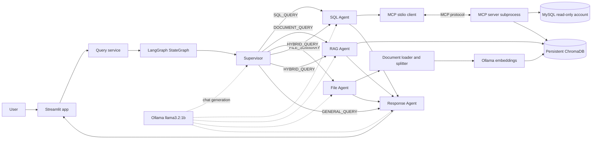

# QueryMate AI

QueryMate AI is a local-first assistant for asking natural-language questions about a MySQL database and uploaded documents. A LangGraph workflow coordinates specialized agents. LangChain connects the agents to Ollama and ChromaDB, and database/document capabilities are exposed over the Model Context Protocol (MCP). Streamlit provides the chat UI.

The automated unit suite runs without MySQL or Ollama by mocking external services. Live integrations are separately opt-in. This README describes implemented code paths and differentiates tested mock coverage from integrations that require local services.

## Features

- Natural-language intent routing for database, document, file-summary, hybrid, and general questions.
- Read-only MySQL access: a single validated `SELECT`, bounded by a row cap and query timeout.
- PDF, DOCX, TXT, CSV, and XLSX extraction with source metadata.
- Persistent local ChromaDB indexing with Ollama `nomic-embed-text` embeddings and semantic retrieval.
- Context-grounded document responses with source references and an insufficient-context response.
- Parallel SQL and RAG branches for hybrid requests.
- Actual MCP Python SDK server/client communication over local stdio.
- Streamlit conversation history, upload, agent activity, SQL, result tables, charts, and document references.
- Local-only Llama model integration; no cloud LLM API.

## Architecture



## Technology stack

Python 3.11+, Streamlit, LangChain, LangGraph, the official Python MCP SDK, Ollama, MySQL Connector/Python, ChromaDB, Pandas, Plotly, PyPDF, python-docx, openpyxl, SQLGlot, and Pytest. Dependency ranges are listed in `requirements.txt`.

## Agents and LangGraph workflow

| Agent | Responsibility |
| --- | --- |
| Supervisor | Classifies intent using the local chat model and deterministic fallback; chooses specialists. |
| SQL | Discovers schema through MCP, generates SQL, validates it locally, and invokes the MCP SQL tool. |
| RAG | Retrieves relevant chunks from Chroma and answers from retrieved evidence with citations. |
| File | Extracts uploaded files, ingests them, and summarizes extracted content. |
| Response | Combines specialist outputs into plain-language text and preserves SQL rows and sources for the UI. |

Workflow: `START → Supervisor → conditional route → specialist node(s) → Response → END`. Hybrid routing returns SQL and RAG branches together; LangGraph executes both branches before the response node. General requests go directly to the response node; file summaries use File Agent then Response. Retries are bounded by `AGENT_MAX_RETRIES`; graph recursion is bounded by `GRAPH_RECURSION_LIMIT`. Conversation history is passed into intent and response prompts with a bounded recent-turn window.

## MCP implementation

`mcp_server/server.py` defines seven actual MCP tools using the official SDK `FastMCP` API: `list_tables`, `get_database_schema`, `describe_table`, `execute_readonly_sql`, `search_documents`, `list_uploaded_documents`, and `get_document_content`. Tool handlers validate inputs and return structured `{ok, result}` or safe `{ok, error}` responses. The client launches the server as a local stdio subprocess, initializes an MCP session, discovers tool schemas, and calls tools using MCP protocol messages. The SQL agent uses this client for schema and query operations. The MCP child receives only the settings it needs through its process environment.

Run from the project root:

```powershell
python -m mcp_server.server
```

The server speaks stdio; do not type commands into its terminal. In another terminal, verify client startup and discovery:

```powershell
python -m mcp_client.client
```

The opt-in MCP server integration test starts a subprocess and invokes every tool, but requires the explicit integration switches and running local dependencies described under Testing. The subprocess integration was not verifiable in the current Windows sandbox because asyncio subprocess startup stalled.

## RAG pipeline

The file loader extracts text and metadata (filename, file type, PDF page, or spreadsheet sheet). The LangChain splitter preserves metadata and adds chunk positions. Chunks receive content-derived document IDs and deterministic chunk IDs; Chroma’s LangChain store calls the configured Ollama embedding client when adding documents. The persistent directory is `CHROMA_PERSIST_DIR`. Retrieval uses semantic relevance scores and `RETRIEVAL_MIN_RELEVANCE_SCORE`; low-relevance matches are filtered. RAG returns an explicit insufficient-context response without asking the model when nothing meets the threshold.

Public operations are available through `rag.pipeline`: `ingest_document`, `ingest_multiple_documents`, `retrieve_documents`, `delete_document`, and `list_documents`. The MCP document tools query the same Chroma collection. Uploaded private data and generated Chroma data are gitignored.

## Project structure

```text
QueryMate-AI/
├── app.py
├── agents/                 # Supervisor, SQL, RAG, file, response specialists
├── config/                 # Environment settings and centralized logging
├── database/               # MySQL connection, schema, executor, SQL safety
├── graph/                  # Typed state, nodes, StateGraph workflow
├── llm/                    # Cached Ollama chat and embedding clients
├── mcp_client/             # Protocol client and LangChain tool adapter
├── mcp_server/             # FastMCP server and validated tool handlers
├── rag/                    # Extraction, chunking, persistent Chroma, retrieval
├── services/               # Health, upload, query, and chart services
├── ui/                     # Reusable Streamlit result rendering
├── data/
│   ├── samples/             # Synthetic company DB, queries, and RAG docs
│   ├── uploads/             # Local uploads (ignored)
│   └── chroma_db/           # Local vector store (ignored)
├── scripts/                # Local Ollama smoke check
└── tests/                  # Unit and opt-in integration tests
```

## Installation

Use Python 3.11 or newer. From the project directory:

```powershell
py -3.11 -m venv .venv
.venv\Scripts\Activate.ps1
python -m pip install --upgrade pip
python -m pip install -r requirements.txt
Copy-Item .env.example .env
```

Edit `.env` for your local environment. Do not commit it. If PowerShell blocks activation, run `python -m pip` using `.venv\Scripts\python.exe` directly.

## Ollama setup

Install Ollama, then pull both configured models:

```powershell
ollama pull llama3.2:1b
ollama pull nomic-embed-text
```

Start the Ollama service if it is not already running:

```powershell
ollama serve
```

Verify server reachability and both configured model names in the Streamlit sidebar, or run the inference smoke script:

```powershell
python -m scripts.test_ollama
```

The smoke script makes real local model requests. Unit tests mock those requests and do not prove local inference works.

## MySQL setup

Create `company_db` and load the included synthetic schema and data using an administrative MySQL account during initial setup:

```powershell
mysql -u root -p
```

Then at the MySQL prompt, from a client configured to access the project directory (or use absolute paths):

```sql
SOURCE D:/QueryMateAI/data/samples/company_db_schema.sql;
SOURCE D:/QueryMateAI/data/samples/company_db_seed.sql;
```

The sample database contains six departments, 36 fictional employees, 12 projects, 46 attendance entries, and 12 leave requests. It has foreign keys and indexes for department, salary, joining date, project state/date, attendance date/status, and employee leave lookup. Re-running the seed file upserts the explicit sample IDs.

For application use, create the dedicated account with only `SELECT` and `SHOW VIEW` on this schema. Edit the placeholder password in `data/samples/company_db_readonly_user.sql`, then run it as a MySQL administrator:

```sql
SOURCE D:/QueryMateAI/data/samples/company_db_readonly_user.sql;
```

Set `MYSQL_DATABASE=company_db`, `MYSQL_USER=querymate_readonly`, and `MYSQL_PASSWORD` to the same password in `.env`. The application code validates one read-only `SELECT`, uses a read-only transaction, imposes a query timeout, and caps rows. Integration tests never create/modify data and use only `SELECT` statements. SQL initialization and user setup files perform writes by design; execute them only on a local/demo MySQL instance, never against production.

Useful natural-language questions include “Which department has the highest average salary?”, “Show active projects by department”, “Who was absent on March 3, 2025?”, “Which leave requests are pending?”, “Who earns more than 90,000?”, and “List the longest-tenured employees.” Equivalent read-only SQL examples are in `data/samples/company_db_sample_queries.sql`.

## Environment variables

| Variable | Default | Purpose |
| --- | --- | --- |
| `APP_NAME`, `APP_ENV`, `LOG_LEVEL` | QueryMate AI, development, INFO | Application identity and logs |
| `OLLAMA_BASE_URL` | `http://localhost:11434` | Local Ollama endpoint |
| `OLLAMA_CHAT_MODEL` | `llama3.2:1b` | Local chat model |
| `OLLAMA_EMBEDDING_MODEL` | `nomic-embed-text` | Local embedding model |
| `OLLAMA_TEMPERATURE` | `0.0` | Chat temperature |
| `OLLAMA_TIMEOUT_SECONDS` | `120` | Ollama request timeout |
| `MYSQL_HOST`, `MYSQL_PORT`, `MYSQL_DATABASE` | localhost, 3306, company_db | MySQL address/schema |
| `MYSQL_USER`, `MYSQL_PASSWORD` | querymate_readonly, empty | Least-privilege credentials |
| `MYSQL_CONNECT_TIMEOUT` | `10` | Connector timeout |
| `SQL_MAX_ROWS` | `500` | Maximum fetched result rows |
| `SQL_QUERY_TIMEOUT_SECONDS` | `15` | MySQL query execution limit |
| `UPLOAD_DIR`, `CHROMA_PERSIST_DIR` | data/uploads, data/chroma_db | Local storage paths |
| `MAX_UPLOAD_SIZE_MB` | `25` | Maximum upload size |
| `CHUNK_SIZE`, `CHUNK_OVERLAP` | `1000`, `150` | Text chunk settings |
| `RETRIEVAL_TOP_K`, `RETRIEVAL_MIN_RELEVANCE_SCORE` | `5`, `0.15` | Retrieval count and relevance cutoff |
| `GRAPH_RECURSION_LIMIT`, `AGENT_MAX_RETRIES` | `12`, `1` | Workflow bounds |
| `MCP_SERVER_COMMAND`, `MCP_SERVER_ARGS` | python, `mcp_server/server.py` | Local MCP subprocess command |

All variables are listed in `.env.example`. Settings are loaded by `config/settings.py`. Credentials are not passed to agent prompts or returned by MCP tools.

## Run Streamlit

With Ollama and MySQL configured, launch:

```powershell
streamlit run app.py
```

Upload one or more supported files in the sidebar, then ask questions in chat. Conversation history is held in Streamlit session state and passed to the workflow. SQL responses can render a query, a dataframe, and an inferred Plotly chart; document responses include source references.

## Example questions

- `List the customers in the database.`
- `What does the uploaded annual report say about revenue?`
- `Summarize the uploaded spreadsheet.`
- `Compare revenue in the database with the uploaded quarterly report.`
- `How many orders are in the database, and what does the policy document say about refunds?`

## Testing and integration verification

Run the default suite:

```powershell
python -m pytest -q
```

In restricted Windows environments where pytest cannot write to its default temporary directory:

```powershell
python -m pytest -q --basetemp=.pytest-tmp
```

Unit coverage includes file parsing for all supported extensions and corrupt/empty cases, mocked Ollama checks, SQL validation and mocked DB execution, mocked MCP handlers/client adapter, graph routing and hybrid branch coordination, RAG source/no-evidence behavior, Streamlit application flow, and chart rendering. These tests do not establish connectivity to user services.

Opt-in local integration cases require both switches, a running Ollama server with both models, and a dedicated MySQL database whose name starts with `querymate_test`:

```powershell
$env:QUERYMATE_RUN_INTEGRATION = "1"
$env:QUERYMATE_RUN_LOCAL_INTEGRATION = "1"
$env:QUERYMATE_TEST_MYSQL_DATABASE = "querymate_test"
python -m pytest -q -m integration
```

Configure the corresponding MySQL host/user/password in the environment. The integration tests perform only `SELECT` statements against the configured test schema. The local RAG integration ingests a temporary in-memory sample into the configured Chroma path; use a dedicated test Chroma directory if you need isolation. The MCP integration starts the real stdio server subprocess and discovers and invokes each tool. Live integration tests were not run as part of this review unless the above services and variables are available in the current environment; see the review checklist for observed results.

## Troubleshooting

- **Ollama offline:** start `ollama serve`, check `OLLAMA_BASE_URL`, then check `ollama list` for both model tags.
- **Model missing:** run `ollama pull llama3.2:1b` and `ollama pull nomic-embed-text`.
- **MySQL unavailable:** check host/port/schema and that the configured account can connect and has `SELECT` permission.
- **MCP cannot start:** launch commands from the project root; verify `MCP_SERVER_COMMAND` points to the same Python environment that installed `mcp`.
- **No document matches:** verify ingestion status, the persistent Chroma directory, and `RETRIEVAL_MIN_RELEVANCE_SCORE`; irrelevant chunks below the cutoff are discarded.
- **Unsupported/corrupt document:** ensure the file is non-empty and has a supported `.pdf`, `.docx`, `.txt`, `.csv`, or `.xlsx` suffix.
- **SQL rejected:** only one parsed MySQL `SELECT` is allowed. Writes, DDL, multiple statements, `SELECT INTO`, locking reads, and selected risky functions are blocked.
- **Windows temp permission errors:** use `--basetemp=.pytest-tmp` as shown above.

## Implemented feature checklist and limitations

- [x] Streamlit calls LangGraph via the query service and displays streamed node activity.
- [x] LangGraph routes supported intents; hybrid SQL and RAG outputs are joined before response generation.
- [x] Specialist model calls use a cached LangChain Ollama chat client; embeddings use the configured Ollama embedding client.
- [x] Persistent Chroma storage, document ingestion/retrieval/list/delete, and source metadata are implemented.
- [x] MySQL schema and query operations use Connector/Python and read-only execution guards.
- [x] Seven operations are declared as MCP tools; the Python client uses stdio MCP sessions and schema discovery.
- [x] Streamlit maintains per-session conversation and renders query results, charts, and source citations.
- [x] Automated default tests pass in the current environment (see the final reported run).
- [ ] Live MySQL, Ollama inference, persistent Chroma retrieval, and real MCP subprocess checks require local services/configuration and must be run in the target environment before claiming deployment readiness. The stdio subprocess test could not be completed in this sandbox because Windows asyncio subprocess initialization stalled.
- [ ] Conversation history is session-local; it is not persisted across browser sessions or users.
- [ ] Authentication, multi-user authorization, database query auditing, and production deployment hardening are outside this local development project.
- [ ] SQL parameterization is not generally applicable to model-generated read-only queries; safety relies on AST validation, least-privilege DB grants, read-only transactions, timeout, and row cap.
- [ ] Retrieval relevance thresholds require tuning against the user's corpus; threshold behavior can omit weakly matching evidence.
